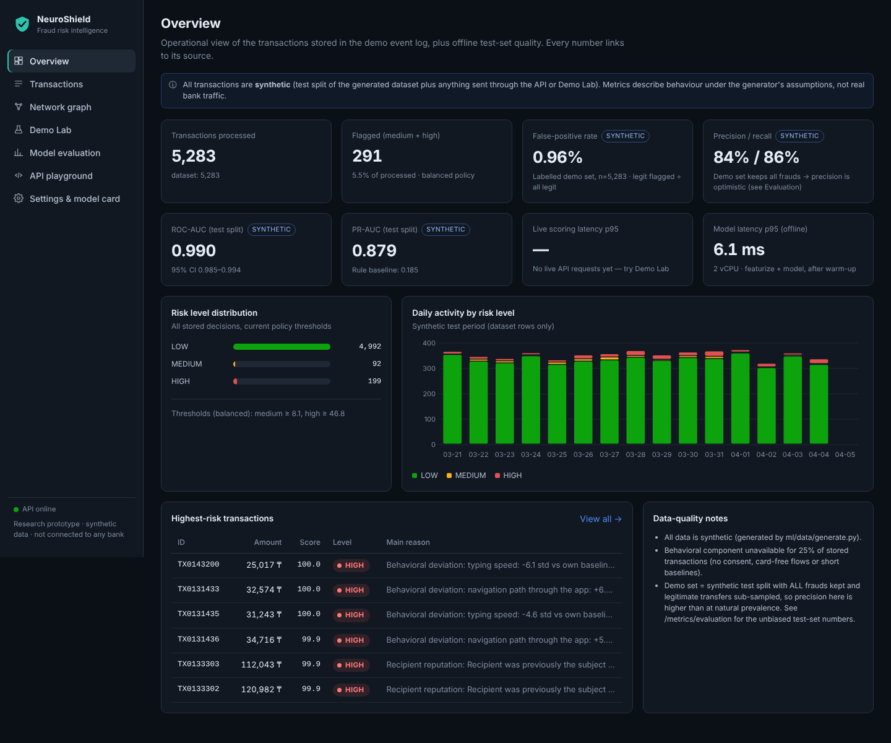

# NeuroShield API

[](https://github.com/tiammms/my-project/actions/workflows/ci.yml)

**Explainable AI Platform for Predictive Fraud Detection and Behavioral Risk Analysis**
*"Detect risk. Understand behavior. Protect every transaction."*

> Независимый исследовательский прототип. Обучен и оценён **только на синтетических данных**. Не подключён ни к какому банку и платёжной системе, не сертифицирован (PCI DSS, ISO 27001 и др.). Все рекомендации симулированы.

**Статус:** все 5 частей готовы: ядро, дашборд, материалы для защиты, исправления и стресс-тесты, доработка сервера и проверка устойчивости. Как работать дальше — `docs/HANDOFF.md`. ML-ядро, backend API и веб-дашборд работают как одно приложение на **одном адресе** http://127.0.0.1:8000. К ним приложены материалы для защиты.

| Для защиты | Файл |
|---|---|
| Презентация (12 слайдов, заметки докладчика) | `presentation/NeuroShield_presentation.pptx` |
| Аналитический отчёт (4 стр.) | `docs/NeuroShield_report.pdf` |
| Тексты слайдов, речь на 30 с / 3 мин / 5 мин | `docs/PITCH.md` |
| 17 ответов на вопросы жюри | `docs/JURY_QA.md` |
| Сценарий видео-демо (80 с) | `docs/VIDEO_SCRIPT.md` |
| Экономическая модель (3 сценария, безубыточность, чувствительность) | `docs/ECONOMICS.md` |
| Архитектура · дорожная карта · чек-лист ТЗ | `docs/ARCHITECTURE.md` · `docs/ROADMAP.md` · `docs/CHECKLIST.md` |



## Что делает система

Транзакция → проверка входа → признаки (`backend/app/services/features.py`, общие для обучения и API) → четыре компонента:

| Компонент | Что оценивает | Тип |
|---|---|---|
| Transaction model | гибридный градиентный бустинг по транзакционным признакам + выходам компонентов | обученная модель (scikit-learn HGB) |
| Behavioral Anomaly | отклонение сессии от *собственной* базовой линии клиента. Отдельно ритм (другой человек?) и колебания (давление?) | детерминированный, только с согласия |
| Graph Risk | фан-ин, сквозная пересылка средств, связь с подтверждёнными жалобами (time-respecting) | детерминированный, NetworkX |
| Social Engineering | совпадение ≥ 2 независимых сигналов: звонок, ответ «меня попросили», новая сумма/получатель, колебания | детерминированный, один сигнал ≤ 45 |

Дальше **Policy Engine** присваивает уровень и действие: LOW → ALLOW, MEDIUM → STEP_UP_VERIFICATION, HIGH → REVIEW_OR_TEMPORARY_HOLD (или MANUAL_REVIEW, если удержания отключены). Объяснение строится групповой окклюзией (не SHAP). Решение пишется в аудит-журнал.

## Измеренные результаты (синтетика)

Полный отчёт: **[`experiments/results/RESULTS.md`](experiments/results/RESULTS.md)** — собирается скриптом из JSON. Ключевое на test split (283 мошеннических из 13 909 транзакций):

| Система | ROC-AUC | PR-AUC |
|---|---|---|
| Правила (8 правил, включая чёрный список) | 0.857 | 0.185 |
| Градиентный бустинг, только транзакции | 0.946 | 0.537 |
| **NeuroShield гибрид (выбран по validation)** | **0.990** | **0.879** |

При том же recall, что у правил (66.8%), FPR снижается с 4.78% до 0.07%. Задержка: модель — p95 6.7 мс, полный HTTP-запрос с объяснением — p95 15.7 мс; под нагрузкой ~95 запросов/с на процесс (2 vCPU Xeon; методика в RESULTS.md).
**Почему этим цифрам нельзя слепо верить:** данные сгенерированы нами, и компоненты отражают допущения генератора. Раздел 7 RESULTS.md показывает, как результаты меняются при других seed и более жёстких допущениях. Реальная эффективность не измерялась.

## Быстрый старт (Python 3.11+, проверено на 3.13). Node.js не нужен

```bash
pip install -r requirements.txt
python -m backend.app.main
```

Или одной командой: **Windows** — двойной щелчок по `run_windows.bat`; **Linux/macOS** — `./run.sh`.

Откройте **http://127.0.0.1:8000**: там дашборд, а Swagger — на `/docs`. Backend сам раздаёт уже собранный дашборд из `frontend/dist`, поэтому фронтенд и API работают на одном адресе, без CORS и без второго сервера.

Модель, политика и демо-набор уже лежат в `ml/artifacts/`. При первом старте backend загружает 5 283 синтетические транзакции из test split в SQLite (`backend/data/`). Чтобы начать с чистого журнала, удалите папку `backend/data/`.

### Дашборд (8 страниц)

| Страница | Что показывает | Источник данных |
|---|---|---|
| Overview | KPI, распределение уровней риска, активность по дням, самые рискованные транзакции | `/metrics/summary`, `/metrics/evaluation`, `/transactions` |
| Transactions | поиск, фильтры, сортировка, пагинация; синтетическая метка для проверки | `/transactions` |
| Transaction details | компоненты риска, отклонения от профиля клиента, факторы «за» и «против», граф, отчёт аналитика | `/transactions/{id}`, `/explanation` |
| Network graph | направленный граф переводов (d3-force), выбор узла, фильтр по риску, алерты с признаками | `/graph/view`, `/graph/alerts` |
| Demo Lab | сценарии A и B рядом и их разница, стенд из 6 проверок на ложные срабатывания | `/demo/scenario` |
| Model evaluation | сравнение 6 систем, ROC/PR, матрицы ошибок, сегменты, абляции, латентность, устойчивость | `/metrics/evaluation` |
| API playground | форма + редактируемый JSON → реальный `POST /risk/score`, ответ и время | `/risk/score` |
| Settings & model card | режим balanced/strict и удержания (меняют скоринг, пишутся в аудит), карточка модели, журнал | `/settings`, `/model/info`, `/audit` |

Скриншоты всех страниц лежат в `docs/screenshots/`.

### Разработка фронтенда (нужен Node.js 18+)

```bash
cd frontend && npm install && npm run build   # → frontend/dist; затем перезапустите backend
npm run dev        # пересборка при изменениях: обновляйте страницу http://127.0.0.1:8000
npm run typecheck
```

Сквозная проверка UI (backend запущен, нужен Playwright): `node scripts/e2e_check.mjs`. Скрипт открывает все страницы, нажимает основные кнопки, падает на ошибках консоли и HTTP и сохраняет скриншоты.

```bash
# пример
curl -X POST localhost:8000/api/v1/demo/scenario -H 'content-type: application/json' -d '{"scenario":"social_engineering"}'
```

Полная воспроизводимая пересборка (данные → обучение → демо-набор → отчёт → экономика → PDF → тесты; нужен `pip install -r requirements-docs.txt`):

```bash
python -m scripts.bootstrap          # ~4 мин, работает на Windows/macOS/Linux;  --full — плюс устойчивость и нагрузка (~12 мин)
```

Тесты: `python -m unittest discover -s backend/tests -t .` (или `pytest backend/tests`).
HTTP-латентность (при запущенном сервере): `python -m scripts.bench_api`.

Если версия scikit-learn отличается от 1.9.1, выполните `python -m scripts.bootstrap`: модель сохранена в pickle и привязана к версии.

## API (v1)

| Метод | Путь | Назначение |
|---|---|---|
| GET | `/health` | Состояние |
| GET | `/api/v1/model/info` | Версия модели, политика, ограничения, калибровка |
| POST | `/api/v1/risk/score` | Оценка одной транзакции |
| POST | `/api/v1/risk/batch` | Пакет до `NS_BATCH_LIMIT` (100) |
| GET | `/api/v1/transactions` | Пагинация, поиск, фильтры, сортировка |
| GET | `/api/v1/transactions/{id}` | Детали и связанные графовые алерты |
| GET | `/api/v1/transactions/{id}/explanation` | Факторы и отчёт для аналитика (6 разделов) |
| GET | `/api/v1/graph/alerts` · `/api/v1/graph/view` | Подозрительные структуры, данные для визуализации |
| GET | `/api/v1/metrics/summary` · `/api/v1/metrics/evaluation` | Операционная сводка, офлайн-оценка |
| GET/POST | `/api/v1/demo/scenarios` · `/api/v1/demo/scenario` | 8 подготовленных сценариев |
| GET | `/api/v1/audit` | Журнал решений и изменений политики |
| GET/PUT | `/api/v1/settings` | Режим balanced/strict, удержания вкл/выкл (аудируется) |

## Безопасность и приватность (MVP)

Строгая валидация (`extra=forbid`, диапазоны, шаблоны ID). 422-ошибки не возвращают введённые значения. Лимит тела запроса (413) и пакета. Rate limit (429). Явный CORS allow-list. Заголовки безопасности и CSP. Request ID. В логах только метаданные, без тел запросов. Нет паролей, номеров карт и реальных персональных данных: только псевдонимные синтетические ID. Поведенческие данные используются только при `consent: true` и только в агрегированном виде. При их отсутствии ничего не додумывается. PUT `/settings` закрывается `NS_ADMIN_TOKEN`. Для реального внедрения нужны юридическая проверка, DPIA, security review и согласование с регулятором.

## Структура

```
backend/app/   api/ (routes, framework+OpenAPI) · services/ (features, risk_engine, explain, graph_engine, scenarios, reports)
               database/ (sqlite) · security/ (middleware) · core/ (config) · schemas/ (pydantic)
backend/tests/ 45 тестов (API, валидация, безопасность, сценарии, паритет train/serve, компоненты, TCP_NODELAY, скрипт ULB)
frontend/      React 19 + TypeScript, сборка esbuild · src/pages/ (8 страниц) · src/components/ (UI, SVG-графики) · dist/ (собранный)
ml/            data/generate.py · training/{pipeline,train}.py · evaluation/{run_variants,fairness_experiment,adversary}.py · artifacts/
experiments/results/  evaluation_*.json · sensitivity_summary.json · RESULTS.md
docs/          DECISIONS.md · ARCHITECTURE.md · ECONOMICS.md · PITCH.md · JURY_QA.md · VIDEO_SCRIPT.md · ROADMAP.md · CHECKLIST.md
               HANDOFF.md · NeuroShield_report.pdf · screenshots/ · figures/
presentation/  NeuroShield_presentation.pptx · build_deck.js (цифры читаются из experiments/results)
scripts/       bootstrap.py · dev_server.sh · load_test.py · snapshot_scenarios.py · export_demo_set.py · make_results_md.py · bench_api.py · e2e_check.mjs
               economics.py · make_report_pdf.py
```

Docker: `docker compose up --build` → http://localhost:8000 (multi-stage: сборка дашборда + API в одном контейнере). Образ собирается и проверяется в CI при каждом push: контейнер запускается, и сквозная UI-проверка проходит все страницы.
