# Архитектура NeuroShield

```mermaid
flowchart LR
  subgraph Client["Клиенты"]
    UI["Веб-дашборд<br/>React + TS (frontend/dist)"]
    EXT["Интегрирующий сервис<br/>(REST)"]
  end
  subgraph API["Backend · Starlette + Pydantic (один процесс, порт 8000)"]
    SEC["Security middleware<br/>лимит тела · rate limit · CSP · request-id"]
    VAL["Валидация схем<br/>extra=forbid, диапазоны"]
    FEAT["Feature contract<br/>features.py (общий с обучением)"]
    subgraph COMP["Компоненты"]
      BEH["Behavioral Anomaly<br/>только с согласия"]
      GR["Graph Risk<br/>контекст получателя/отправителя"]
      SE["Social Engineering<br/>≥2 независимых сигнала"]
      REC["Recipient reputation"]
    end
    MODEL["Гибридная модель<br/>HistGradientBoosting"]
    POL["Policy Engine<br/>LOW→Allow · MEDIUM→Step-up · HIGH→Review/Hold"]
    EXP["Explainability<br/>групповая окклюзия + отчёт"]
    GE["Graph Engine (NetworkX)<br/>fan-in · цепочки · общие получатели"]
    DB[("SQLite<br/>решения · аудит · настройки")]
  end
  subgraph ML["Офлайн-контур (ml/)"]
    GEN["Генератор синтетики<br/>seed 42"] --> TR["Обучение и сравнение 6 систем<br/>разбиение по времени"]
    TR --> ART["Артефакты<br/>model.joblib · policy.json"]
    TR --> RES["experiments/results<br/>метрики · кривые · устойчивость"]
  end
  UI --> SEC
  EXT --> SEC
  SEC --> VAL --> FEAT --> COMP --> MODEL --> POL --> EXP --> DB
  FEAT --> MODEL
  DB --> GE
  ART -.загрузка.-> MODEL
  ART -.пороги.-> POL
  RES -.отчёт.-> UI
```

## Путь одной транзакции

1. `POST /api/v1/risk/score`: middleware проверяет размер тела и частоту запросов, Pydantic проверяет схему (лишние поля, диапазоны, шаблоны ID).
2. `features.py` превращает запрос в признаки. Это **тот же код**, что использовался при обучении; паритет проверяет тест `test_parity_with_offline_pipeline`.
3. Компоненты считают поведенческое отклонение (только при `consent: true`), графовый риск, риск социальной инженерии и репутацию получателя.
4. Гибридная модель выдаёт оценку 0–100. Policy Engine применяет пороги, выбранные на validation, и защитное правило: одно поведение не может привести к HOLD.
5. Окклюзия объясняет вклад групп признаков. Решение и аудит пишутся в SQLite.
6. Дашборд читает те же эндпоинты. Graph Engine строит граф переводов из сохранённых решений.

## Почему так

- **Один процесс и один порт** для API и UI: меньше точек отказа на демонстрации, нет CORS.
- **Детерминированные компоненты плюс обученная модель поверх них**: каждый компонент объясним сам по себе, а модель учится, как их совмещать.
- **NetworkX вместо GNN**: алгоритмы воспроизводимы и объяснимы, а для GNN не хватает реальных размеченных графов.
