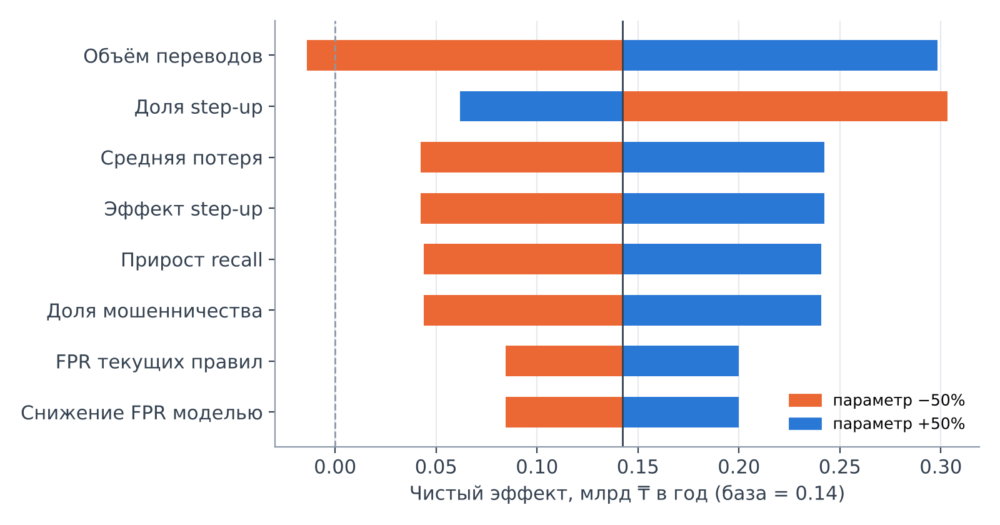

# Экономическая модель NeuroShield

> Все параметры банка — **сценарные допущения**, а не данные реального банка. Качество модели **не** переносится 1:1 из синтетического эксперимента: там снижение FPR — 98.5%, а в сценариях взято 20–60%. Метрики модели сами по себе не доказывают экономию: эффект зависит от объёма операций, стоимости ошибок и качества внедрения. Файл сгенерирован скриптом `scripts/economics.py`.

## Формула

```
Net Benefit = Avoided Fraud Losses + Reduced False-Positive Handling Costs
            − Infrastructure − Integration (амортизация) − Operating
```

Сравнение идёт с **текущими правилами банка** при том же или лучшем recall:

- Обе системы получают **одинаковую** многоуровневую обработку: доля `stepup_share` ложных алертов закрывается дешёвым step-up, остальные идут на ручную проверку. Поэтому эффект от самой политики step-up модели **не** засчитывается.
- NeuroShield даёт меньше ложных алертов при том же recall (`fpr_reduction`).
- Дополнительно пойманные мошенничества (`recall_uplift_pp`) считаются пойманными только на уровне step-up, то есть с более слабым предотвращением (`prevention_stepup`).

## Допущения по сценариям

| Параметр | Консервативный | Базовый | Оптимистичный |
|---|---|---|---|
| Transfers per year | 20,000,000 | 50,000,000 | 100,000,000 |
| Fraud rate (share of transfers) | 0.02% | 0.05% | 0.10% |
| Average loss per fraud, KZT | 300,000 | 400,000 | 500,000 |
| Current rules: false-positive rate | 0.50% | 1.00% | 2.00% |
| Current rules: recall | 50% | 60% | 67% |
| NeuroShield: relative FPR reduction at equal recall | 20% | 35% | 60% |
| NeuroShield: extra recall (percentage points) | +0 п.п. | +5 п.п. | +10 п.п. |
| Share of false alerts closed by step-up instead of manual review (same for rules and NeuroShield) | 70% | 80% | 88% |
| Manual review cost per alert, KZT | 3,000 | 2,500 | 2,000 |
| Step-up friction cost per legit customer, KZT | 300 | 200 | 100 |
| Loss prevented when flagged for review/hold | 70% | 80% | 90% |
| Loss prevented by step-up only | 30% | 40% | 50% |
| Infrastructure per year, KZT | 40,000,000 | 30,000,000 | 25,000,000 |
| Integration (one-time), KZT | 150,000,000 | 120,000,000 | 100,000,000 |
| Integration amortisation, years | 3 | 3 | 3 |
| Operating (team, monitoring) per year, KZT | 120,000,000 | 100,000,000 | 80,000,000 |

## Результат (в год)

| Показатель | Консервативный | Базовый | Оптимистичный |
|---|---|---|---|
| Мошеннических переводов в год | 4,000 | 25,000 | 100,000 |
| Ложных алертов: сейчас | 99,980 | 499,750 | 1,998,000 |
| Ложных алертов: NeuroShield | 79,984 | 324,838 | 799,200 |
| Ручных проверок: сейчас | 31,994 | 114,950 | 306,760 |
| Ручных проверок: NeuroShield | 25,995 | 81,217 | 172,904 |
| Предотвращённые потери (прирост) | 0 млн ₸ | 200 млн ₸ | 2.50 млрд ₸ |
| Экономия на ложных срабатываниях | 22 млн ₸ | 112 млн ₸ | 373 млн ₸ |
| Инфраструктура | 40 млн ₸ | 30 млн ₸ | 25 млн ₸ |
| Интеграция (амортизация) | 50 млн ₸ | 40 млн ₸ | 33 млн ₸ |
| Эксплуатация | 120 млн ₸ | 100 млн ₸ | 80 млн ₸ |
| **Чистый эффект** | -188 млн ₸ | 142 млн ₸ | 2.73 млрд ₸ |
| ROI (чистый эффект / затраты) | -0.89× | 0.84× | 19.77× |
| Окупаемость интеграции | не окупается | 7.9 мес. | 0.4 мес. |

**Справочно (не прогноз):** если перенести синтетические результаты 1:1 (базовые параметры банка, FPR правил 4.78%, снижение 98.5%), чистый эффект был бы 1.38 млрд ₸. Эта цифра показывает, насколько синтетика завышает результат, поэтому в защите её использовать нельзя.

## Точка безубыточности

- Базовый сценарий, только за счёт меньшего числа ложных алертов (без прироста recall): нужно снижение FPR не меньше **51.5%**.
- Базовый сценарий, только за счёт прироста recall (без снижения FPR): нужно ловить на **4.3 п.п.** больше мошенничества, чем правила.
- Консервативный сценарий: не окупается даже при 100% снижении FPR.
- Минимальный объём для безубыточности: **27.2 млн** переводов в год в базовом сценарии, **189.2 млн** в консервативном.

## Чувствительность (базовый сценарий, каждый параметр ±50%)



| Параметр | Чистый эффект при −50% | при +50% |
|---|---|---|
| Transfers per year | -14 млн ₸ | 298 млн ₸ |
| Share of false alerts closed by step-up instead of manual review (same for rules and NeuroShield) | 303 млн ₸ | 62 млн ₸ |
| Average loss per fraud, KZT | 42 млн ₸ | 242 млн ₸ |
| Loss prevented by step-up only | 42 млн ₸ | 242 млн ₸ |
| NeuroShield: extra recall (percentage points) | 44 млн ₸ | 241 млн ₸ |
| Fraud rate (share of transfers) | 44 млн ₸ | 241 млн ₸ |
| Current rules: false-positive rate | 85 млн ₸ | 200 млн ₸ |
| NeuroShield: relative FPR reduction at equal recall | 85 млн ₸ | 200 млн ₸ |
| Operating (team, monitoring) per year, KZT | 192 млн ₸ | 92 млн ₸ |
| Manual review cost per alert, KZT | 100 млн ₸ | 184 млн ₸ |
| Integration (one-time), KZT | 162 млн ₸ | 122 млн ₸ |

## Ограничения

- Нет данных реального банка: объёмы, доля мошенничества и стоимость операций — допущения. На пилоте их нужно заменить фактическими.
- Снижение FPR и прирост recall нужно измерить в shadow mode на реальном трафике (этап 2 дорожной карты).
- Не учтены регуляторные расходы, репутационный эффект, отток клиентов из-за трения, стоимость дообучения при дрейфе и юридические издержки.
- Предотвращение потерь после алерта зависит от процесса банка (скорость звонка клиенту, возможность задержать перевод).
